# 🩺 RN Ready

**Nursing Board Exam Review App** · `Mobile`

Comprehensive nursing review app with AI tutor, clinical cases, practice quizzes, anatomy lab, and study materials for PNLE preparation.

## Screenshots

### Study hub — the home screen organizes all review tools (AI Tutor, Clinical Case, Care Plan, Anatomy Lab) into a single dashboard. The "Ready to pass the PNLE?" headline speaks directly to the student's goal.

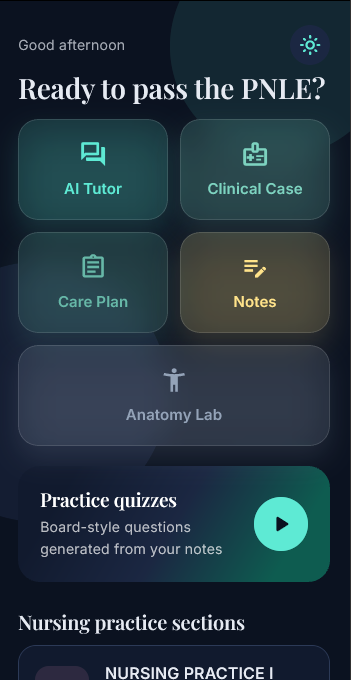

### AI Tutor — students ask any nursing question in natural language and receive instant explanations. This replaces waiting for an instructor and is available 24/7 for late-night study sessions.

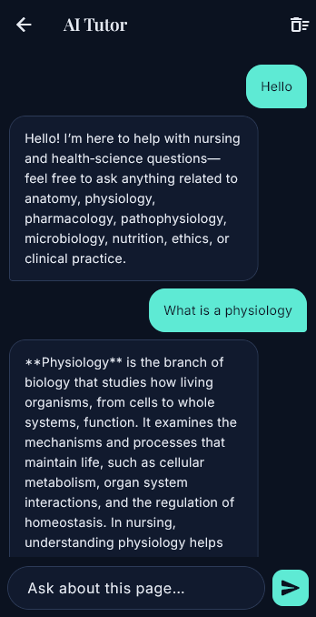

### Clinical case library — organizes real-world nursing scenarios by specialty (pharmacology, emergencies, ethics). Students choose a category to practice critical thinking in context, not just memorize facts.

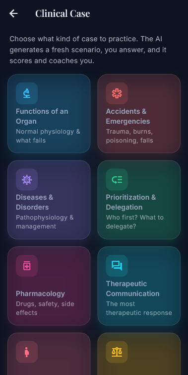

### Expanded case categories — reveals additional specialties like Maternal & Child Health and Infection Control, covering the full PNLE syllabus so no exam topic is left unpracticed.

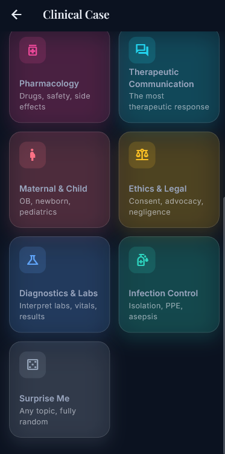

### Personal study journal — lets nurses jot down clinical observations, mnemonics, or reflection notes. The "New note" button provides quick capture during study breaks.

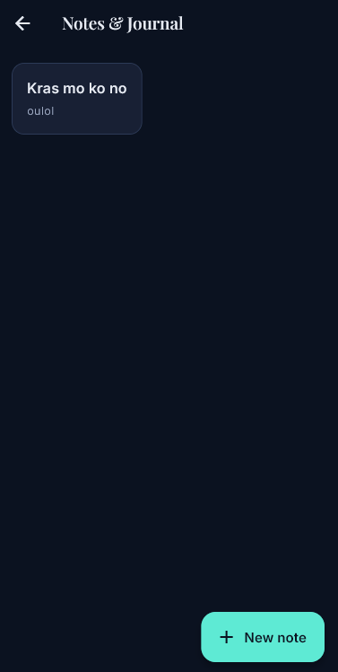

### Anatomy Lab menu — visual cards for each body system (heart, neurons, skin, bones, eyes, lungs) let students choose which anatomy topic to practice labeling. Visual learning reinforces textbook study.

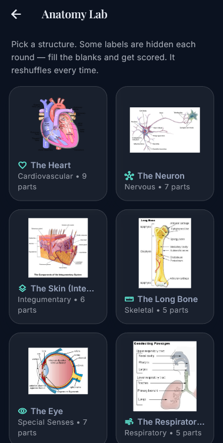

### Interactive anatomy exercise — students label numbered parts of the heart diagram. Immediate feedback on correct answers (Aorta, Right atrium) reinforces spatial memory of anatomical structures.

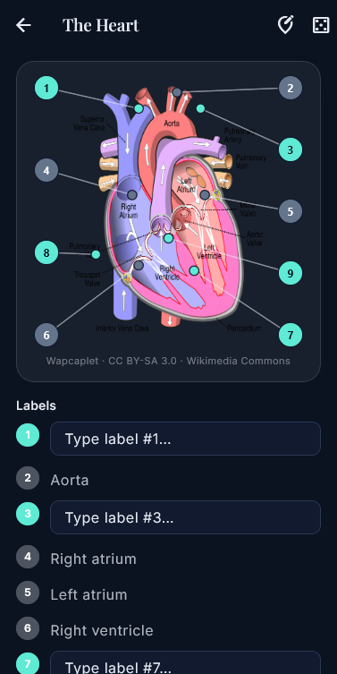

### Quiz topic browser — lists all subtopics under Nursing Practice I with completion progress (0/56). Students can see exactly which topics they haven't studied yet and prioritize accordingly.

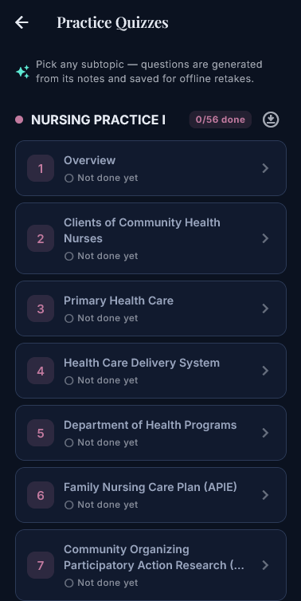

### Quiz configuration — lets students choose question types (multiple choice, identification) and start a focused session on specific subtopics rather than random questions.

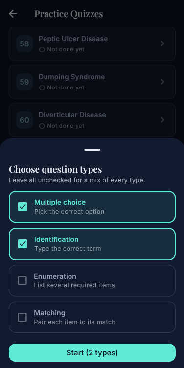

### Timed quiz in progress — 10-minute timer with multiple-choice questions simulates real PNLE pressure. The countdown trains students to manage time during the actual board exam.

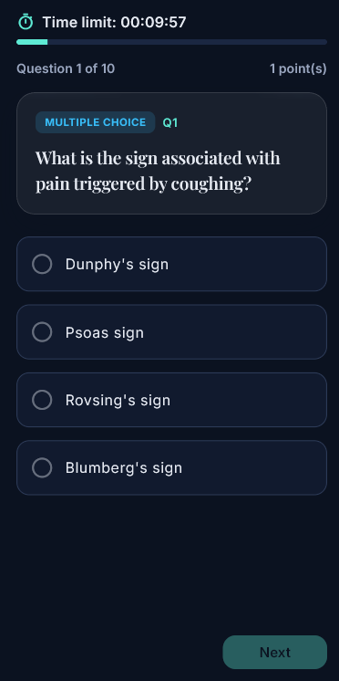

### Results with rationale — shows score, time used, and most importantly WHY each answer was right or wrong. The detailed review transforms mistakes into learning opportunities.

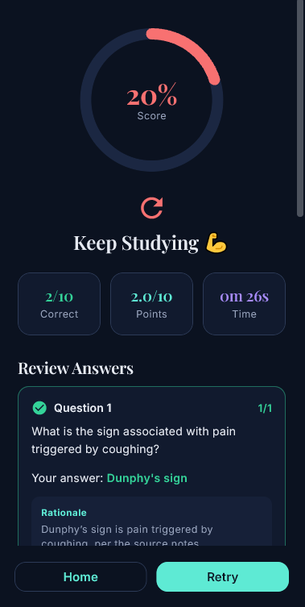

### Study material reader — presents structured content (DOH programs, laws, nursing theories) with pagination. "Ask AI" and "Quiz this subtopic" buttons turn passive reading into active learning.

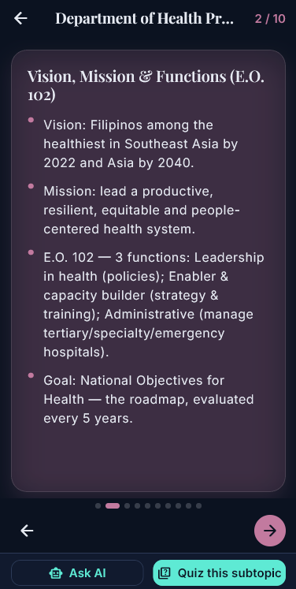

## Features

- AI Tutor chat for nursing and health science questions
- Clinical case studies across 10+ specialty categories
- Timed practice quizzes with answer review and rationale
- Interactive anatomy labeling activities
- Notes & journal for personal study
- Study materials with Ask AI integration

## Tech Stack

- React Native
- Expo
- Supabase
- OpenAI API

## About

A mobile review application for the Philippine Nursing Licensure Examination (PNLE). Combines AI-powered tutoring, clinical case simulations, anatomy exercises, and structured practice quizzes with detailed answer explanations.

---

Built by [Mark Crysler Baddo](https://github.com/Kuraisura) · [Portfolio](https://kuraisler.xyz)
